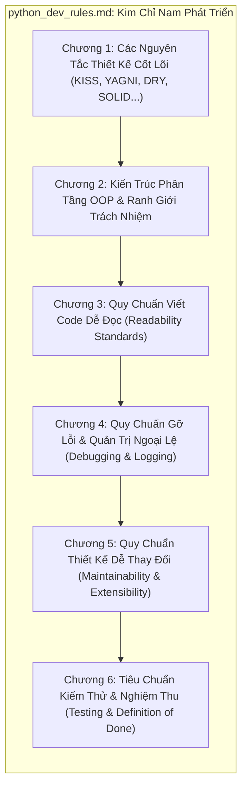

# QUY CHUẨN THỰC THI LẬP TRÌNH PYTHON (PYTHON DEV RULES)
## ÁP DỤNG CHO 2 TÍNH NĂNG: ĐĂNG KÝ HỘI VIÊN KÈM GÓI TẬP & ĐIỂM DANH HỘI VIÊN
**Tài liệu tham chiếu:** [`UI/task.md`](../UI/task.md) | [`doc/ref_dev_rule.md`](ref_dev_rule.md) | [`doc/GymManagement_Physical_Model.sql`](GymManagement_Physical_Model.sql)  
**Công nghệ:** Python 3.10.11 • MySQL 8.0 (Docker Container) • mysql-connector-python • Layered OOP Architecture

---

## MỤC TIÊU & PHẠM VI ÁP DỤNG

Tài liệu này là **Quy chuẩn Lập trình Bắt buộc (Mandatory Python Development Standard)** dành riêng cho 2 tính năng nghiệp vụ cốt lõi:
1. **Tính năng 1: Đăng ký hội viên mới kèm gói tập (`UC02.1` + `UC05.1`)** (`User`, `PackagePlan`, `MemberSubscription`, `Invoice`, `Notification`).
2. **Tính năng 2: Điểm danh hội viên vào phòng tập (`UC03.1` + `UC03.2`)** (`CheckInLog`, `MemberSubscription`, `User`).

Mọi dòng code Python khi được thêm mới hoặc chỉnh sửa bắt buộc phải tuân thủ 100% các nguyên tắc kiến trúc, quy chuẩn viết code dễ đọc, dễ gỡ lỗi (debug) và dễ bảo trì/thay đổi dưới đây.



---

## CHƯƠNG 1: CÁC NGUYÊN TẮC THIẾT KẾ CỐT LÕI (CORE DESIGN PRINCIPLES)

```text
[1. KISS] ── [2. YAGNI] ── [3. DRY] ── [4. SOLID] ── [5. Fail-Fast] ── [6. POLA] ── [7. Boy Scout]
```

### 1.1. KISS (Keep It Simple, Stupid) — Đơn Giản Là Thượng Sách
* **Tính dễ đọc là ưu tiên số 1:** Viết code tường minh, trực diện. Tránh viết những câu lệnh một dòng (one-liners) phức tạp, list comprehension lồng ghép nhiều tầng gây khó khăn khi debug bằng breakpoint.
* **Hạn chế toán tử 3 ngôi (Ternary Operator) lồng nhau:** Chỉ dùng `a if condition else b` cho các phép gán đơn giản. Nghiêm cấm lồng ghép nhiều tầng ternary. Nếu có từ 2 điều kiện trở lên, bắt buộc dùng `if / elif / else` hoặc Guard Clause.
* **Chống Over-Engineering:** Không tự ý tạo thêm các tầng trung gian trừu tượng không cần thiết. Không dùng Meta-programming, Dynamic Eval, hay Reflection khi chỉ cần Class OOP và Hàm thông thường là đủ.
* **Hàm ngắn gọn, đơn mục đích:** Mỗi hàm lý tưởng chỉ nên dài từ 15 đến 35 dòng, giải quyết trọn vẹn đúng 1 mục tiêu duy nhất.

### 1.2. YAGNI (You Aren't Gonna Need It) — Chỉ Làm Đúng Những Gì Cần
* **Tuyệt đối không lập trình đón đầu tương lai:** Chỉ hiện thực đúng các trường dữ liệu và phương thức cần thiết cho 2 tính năng theo [`doc/GymManagement_Physical_Model.sql`](GymManagement_Physical_Model.sql).
* Không tự ý thêm bảng trung gian, không thêm cột "dự phòng" (ví dụ: điểm tích lũy, ví điện tử nội bộ), không viết code cho các tính năng chưa yêu cầu.

### 1.3. DRY (Don't Repeat Yourself) — Không Nhân Bản Logic
* **Tập trung quy tắc nghiệp vụ tại tầng Service:** Logic kiểm tra tính hợp lệ của thẻ (hạn dùng, số buổi còn lại, trạng thái `ACTIVE`), logic tính tiền hóa đơn chỉ được viết **DUY NHẤT MỘT NƠI** trong `MemberService` và `CheckInService`.
* Cấm tuyệt đối sao chép (copy-paste) các đoạn SQL giống nhau sang nhiều file. Gom các truy vấn chung vào tầng `Repository`.
* **Ranh giới hợp lý (Rule of Three):** Không gượng ép DRY giữa các tầng kiến trúc khác nhau (ví dụ: không dùng chung dictionary thô của database cho tầng UI chỉ để "tiết kiệm tạo class Model").

### 1.4. SOLID Principles (Tối Ưu Cho Python OOP)
* **Single Responsibility Principle (SRP):** Mỗi class chỉ đảm nhiệm một lý do duy nhất để thay đổi:
  * `UserRepository`: Chỉ phụ trách truy vấn SQL bảng `User`.
  * `MemberService`: Chỉ phụ trách luồng nghiệp vụ tạo hội viên và điều phối giao dịch.
  * `RegisterMemberDialog`: Chỉ phụ trách thu thập input từ người dùng và hiển thị giao diện.
* **Open/Closed Principle (OCP):** Thiết kế mở rộng bằng cách kế thừa `BaseModel`, `BaseRepository` hoặc truyền Strategy/Callback mà không sửa đổi mã nguồn gốc đang ổn định.
* **Liskov Substitution Principle (LSP):** Mọi Model con kế thừa `BaseModel` đều có thể thay thế hoàn toàn cho `BaseModel` trong các hàm xử lý dữ liệu chung mà không gây lỗi runtime.
* **Interface Segregation Principle (ISP):** Các repository chỉ cung cấp đúng các phương thức cần thiết cho nghiệp vụ, không ép buộc một class phải kế thừa các hàm mà nó không dùng.
* **Dependency Inversion Principle (DIP):** Các lớp cấp cao (`MemberService`, `CheckInService`) phụ thuộc vào Abstraction (`BaseRepository` hoặc Repository Instance được truyền vào qua Constructor Injection), không khởi tạo cứng kết nối CSDL bên trong.

### 1.5. Fail-Fast & Guard Clauses (Báo Lỗi Sớm, Dứt Khoát)
* **Kiểm tra hợp lệ ngay đầu hàm:** Bắt lỗi tham số `None`, rỗng hoặc sai định dạng ngay khi vừa bước vào hàm. Ném ngoại lệ hoặc trả về lỗi ngay lập tức, không để dữ liệu sai đi sâu vào hệ thống rồi mới phát sinh lỗi.
* **Loại bỏ lồng ghép if/else (Arrow Anti-Pattern):** Dùng Guard Clauses để luồng xử lý chính (Happy Path) luôn nằm ở cấp thụt lề thấp nhất.

### 1.6. POLA (Principle of Least Astonishment) — Không Gây Bất Ngờ
* Tên hàm phải phản ánh chính xác hành vi: Hàm `get_active_subscription()` chỉ được phép truy vấn và trả về dữ liệu, **tuyệt đối không được ngầm trừ số buổi tập hay ghi log vào CSDL**. Phân định rõ ràng giữa lệnh thay đổi trạng thái (Command) và lệnh lấy dữ liệu (Query).

### 1.7. Boy Scout Rule — Luôn Dọn Dẹp Code Sạch Hơn Khi Rời Đi
* Khi sửa đổi hoặc bổ sung code vào bất kỳ file nào (`views`, `dialogs`, `models`), nếu phát hiện biến không dùng, import thừa, comment lỗi thời, hoặc mã không chuẩn type hint, hãy dọn dẹp ngay.

---

## CHƯƠNG 2: KIẾN TRÚC PHÂN TẦNG OOP & RANH GIỚI TRÁCH NHIỆM

```text
UI Page / Dialog (PyQt6)
       │  (Truyền DTO / Dict sạch)
       ▼
Service Layer (Giao dịch, Validate nghiệp vụ, Sinh QR, Commit/Rollback)
       │  (Truyền Domain Model)
       ▼
Repository Layer (SELECT, INSERT, UPDATE tham số hóa %s)
       │  (Connection Pool / Cursor)
       ▼
DatabaseConnection (MySQL 8.0 Container)
```

### 2.1. Phân Chia Thư Mục Chuẩn OOP

```text
UI/
├── database/
│   └── db_connection.py         # Singleton Connection Pool, Context Manager transaction()
├── models/
│   ├── base_model.py            # BaseModel: to_dict(), from_row()
│   ├── role.py                  # Entity Role
│   ├── user.py                  # Entity User (Member, Admin)
│   ├── package_plan.py          # Entity PackagePlan
│   ├── member_subscription.py   # Entity MemberSubscription + is_eligible_for_checkin()
│   ├── invoice.py               # Entity Invoice
│   ├── check_in_log.py          # Entity CheckInLog
│   └── notification.py          # Entity Notification
├── repositories/
│   ├── base_repository.py       # Generic BaseRepository[T]
│   ├── user_repository.py       # Truy vấn bảng User
│   ├── package_plan_repo.py     # Truy vấn bảng PackagePlan
│   ├── subscription_repo.py     # Truy vấn bảng MemberSubscription
│   ├── invoice_repository.py    # Truy vấn bảng Invoice
│   └── check_in_repo.py         # Truy vấn bảng CheckInLog
├── services/
│   ├── member_service.py        # Nghiệp vụ Đăng ký trọn gói (Atomic Transaction)
│   └── checkin_service.py       # Nghiệp vụ Điểm danh & Trừ lượt
└── desktop_portal/
    ├── dialogs/
    │   └── register_member_dialog.py
    └── views/
        ├── checkin_counter_page.py
        ├── members_page.py
        └── pos_billing_page.py
```

### 2.2. Ràng Buộc Kiến Trúc Tuyệt Đối (Architectural Constraints)
1. **CẤM SQL TRONG TẦNG GIAO DIỆN (UI):** Các file trong `desktop_portal/` tuyệt đối không được chứa bất kỳ chuỗi `SELECT`, `INSERT`, `UPDATE`, `DELETE` nào.
2. **CẤM IMPORT PYQT6 TRONG SERVICE & REPOSITORY:** Tầng Service và Data Access phải độc lập hoàn toàn với framework UI. Không import `QWidget`, `QMessageBox`, `QColor` vào `services/` hoặc `repositories/`.
3. **CẤM HARDCODE THÔNG TIN KẾT NỐI:** Toàn bộ thông tin kết nối MySQL (Host, Port, User, Password, Database) phải được đọc từ biến môi trường hoặc file cấu hình tập trung.

---

## CHƯƠNG 3: QUY CHUẨN VIẾT CODE DỄ ĐỌC (READABILITY STANDARDS)

### 3.1. Chuẩn Đặt Tên (Naming Conventions)
* **Tệp tin (Module):** `snake_case` (ví dụ: `member_service.py`, `checkin_counter_page.py`).
* **Lớp (Class):** `PascalCase` (ví dụ: `MemberSubscription`, `UserRepository`).
* **Hàm / Phương thức:** `snake_case` có động từ rõ nghĩa (ví dụ: `find_by_phone()`, `is_eligible_for_checkin()`, `decrement_sessions()`).
* **Biến số / Thuộc tính:** `snake_case` danh từ rõ nghĩa (ví dụ: `remaining_sessions`, `subscription_id`). Cấm dùng biến 1 chữ cái như `x`, `p`, `temp` ngoại trừ biến đếm vòng lặp `i`, `row`.
* **Hằng số (Constants):** `UPPER_SNAKE_CASE` (ví dụ: `DEFAULT_PORT`, `MAX_ATTEMPTS`).

### 3.2. Type Hints 100% Cho Mọi Chữ Ký Hàm
Tất cả các tham số và kiểu trả về của hàm public đều phải có Type Hints tường minh:

```python
from typing import Optional, List, Tuple
from datetime import date
from models.member_subscription import MemberSubscription

def get_active_subscription(self, username: str) -> Optional[MemberSubscription]:
    """Tìm kiếm gói tập đang ACTIVE của hội viên."""
    ...

def process_checkin(self, qr_token: str, method: str) -> Tuple[bool, str, Optional[dict]]:
    """Xử lý điểm danh và trả về kết quả 3 thành phần."""
    ...
```

### 3.3. Quy Chuẩn Docstrings Chuẩn Google Style

```python
class MemberService:
    """Cung cấp các dịch vụ nghiệp vụ liên quan đến Hội viên và Gói tập."""

    def register_new_member(
        self, 
        member_dto: dict, 
        plan_id: str, 
        payment_method: str, 
        admin_username: str
    ) -> Tuple[bool, str, Optional[dict]]:
        """Đăng ký hội viên mới kèm gói tập và lập hóa đơn thu tiền (UC02.1 & UC05.1).

        Args:
            member_dto: Dictionary chứa thông tin cá nhân (full_name, phone, email, username).
            plan_id: Mã gói tập niêm yết được chọn từ PackagePlan.
            payment_method: Phương thức thanh toán ('CASH', 'VIETQR'). Tuyệt đối không dùng POS.
            admin_username: Tên đăng nhập của nhân viên quầy thực hiện.

        Returns:
            Tuple gồm:
                - bool: True nếu hoàn tất thành công, False nếu thất bại.
                - str: Thông điệp phản hồi người dùng bằng tiếng Việt.
                - dict: Dữ liệu tóm tắt (username, subscription_id, qr_code, invoice_code) nếu thành công.

        Raises:
            DuplicateUserException: Khi Số điện thoại hoặc Mã hội viên đã tồn tại.
            PackageNotFoundException: Khi không tìm thấy PlanId trong CSDL.
            DatabaseTransactionException: Khi có lỗi trong quá trình ghi dữ liệu.
        """
```

### 3.4. Guard Clauses Triệt Tiêu Lồng Ghép

```python
# ĐÚNG: Xử lý lỗi sớm, luồng chính không thụt dòng sâu
def check_can_enter(self, sub: MemberSubscription) -> Tuple[bool, str]:
    if sub.status != "ACTIVE":
        return False, f"Thẻ đang ở trạng thái '{sub.status}'"
        
    if sub.end_date < date.today():
        return False, f"Thẻ đã hết hạn vào ngày {sub.end_date.strftime('%d/%m/%Y')}"
        
    if sub.remaining_check_in_sessions is not None and sub.remaining_check_in_sessions <= 0:
        return False, "Thẻ đã hết lượt check-in"

    # Luồng chính hợp lệ
    return True, "Hợp lệ"
```

### 3.5. Không Sử Dụng Chuỗi/Số Ma Thuật (Constants Classes)
Tập trung toàn bộ giá trị cố định vào `UI/constants.py`:

```python
# File: UI/constants.py
class RoleID:
    MEMBER = "MEMBER"
    ADMIN = "ADMIN"

class SubscriptionStatus:
    ACTIVE = "ACTIVE"
    EXPIRED = "EXPIRED"
    FROZEN = "FROZEN"
    CANCELLED = "CANCELLED"

class PaymentMethod:
    CASH = "CASH"
    VIETQR = "VIETQR"
    # Lưu ý: Hệ thống không sử dụng hình thức thanh toán quẹt thẻ POS.

class CheckInStatus:
    SUCCESS = "SUCCESS"
    DENIED = "DENIED"

class CheckInMethod:
    QR_SCAN = "QR_SCAN"
    MANUAL = "MANUAL"
```

---

## CHƯƠNG 4: QUY CHUẨN GỠ LỖI & QUẢN TRỊ NGOẠI LỆ (DEBUGGING & LOGGING)

Mã nguồn phải được thiết kế để khi có lỗi xảy ra, lập trình viên có thể xác định chính xác nguyên nhân trong vòng **dưới 60 giây** qua log mà không cần phỏng đoán.

### 4.1. Cây Phân Cấp Ngoại Lệ Nghiệp Vụ Tường Minh (`UI/exceptions.py`)
Nghiêm cấm dùng `except Exception: pass` hoặc ném `Exception` chung chung:

```python
# File: UI/exceptions.py
class GymBaseException(Exception):
    """Lớp ngoại lệ cơ sở cho toàn bộ hệ thống Gym."""
    def __init__(self, message: str, error_code: str = "ERR_INTERNAL"):
        super().__init__(message)
        self.message = message
        self.error_code = error_code

class DuplicateUserException(GymBaseException):
    def __init__(self, field_name: str, value: str):
        super().__init__(
            f"Thông tin {field_name} '{value}' đã tồn tại trong hệ thống.",
            error_code="ERR_DUPLICATE_USER"
        )
        self.field_name = field_name
        self.value = value

class PackageNotFoundException(GymBaseException):
    def __init__(self, plan_id: str):
        super().__init__(f"Không tìm thấy gói tập với mã: '{plan_id}'", error_code="ERR_PACKAGE_NOT_FOUND")

class CheckInDeniedException(GymBaseException):
    def __init__(self, reason: str, username: str):
        super().__init__(f"Từ chối điểm danh hội viên [{username}]: {reason}", error_code="ERR_CHECKIN_DENIED")
        self.reason = reason
        self.username = username

class DatabaseTransactionException(GymBaseException):
    def __init__(self, original_error: Exception):
        super().__init__(f"Lỗi giao dịch cơ sở dữ liệu: {str(original_error)}", error_code="ERR_DATABASE_TX")
        self.original_error = original_error
```

### 4.2. Tiêu Chuẩn Ghi Log Có Cấu Trúc (Structured Logging)
* Mỗi file khởi tạo logger riêng: `logger = logging.getLogger(__name__)`.
* Ghi log kèm ngữ cảnh ID rõ ràng (`username`, `sub_id`, `invoice_code`).

```python
# File: UI/services/checkin_service.py
import logging

logger = logging.getLogger(__name__)

class CheckInService:
    def process_checkin(self, key: str, method: str, admin_id: str) -> Tuple[bool, str, Optional[dict]]:
        logger.info("Bắt đầu điểm danh | Khóa: %s | Phương thức: %s | Lễ tân: %s", key, method, admin_id)
        try:
            # Logic tra cứu
            logger.debug("Tra cứu bản ghi hợp lệ cho khóa: %s", key)
            ...
            logger.info("Điểm danh THÀNH CÔNG hội viên [%s] | Thẻ [%s]", user.username, sub.subscription_id)
            return True, "Điểm danh thành công!", {"username": user.username}
        except CheckInDeniedException as ex:
            logger.warning("Điểm danh BỊ TỪ CHỐI | Hội viên: [%s] | Lý do: %s", ex.username, ex.reason)
            return False, ex.reason, None
        except Exception as ex:
            logger.error("LỖI HỆ THỐNG khi điểm danh khóa [%s]: %s", key, str(ex), exc_info=True)
            return False, "Lỗi kết nối máy chủ!", None
```

### 4.3. Bảo Toàn Stack Trace Bằng `raise ... from e`
Khi wrap ngoại lệ tầng CSDL sang ngoại lệ nghiệp vụ, luôn giữ vết cội nguồn lỗi:

```python
try:
    cursor.execute(sql, params)
except mysql.connector.Error as err:
    logger.error("Lỗi thực thi SQL [%s]: %s", sql, err.msg, exc_info=True)
    raise DatabaseTransactionException(err) from err
```

### 4.4. Đo Thời Gian Thực Thi Bằng Decorator (`@measure_time`)
Mọi truy vấn hoặc hàm xử lý tại quầy lễ tân phải đảm bảo thời gian chạy $< 1000\text{ms}$. Gắn decorator đo kiểm tại `UI/utils/profiler.py`:

```python
import time
import functools
import logging

logger = logging.getLogger("PROFILER")

def measure_time(func):
    @functools.wraps(func)
    def wrapper(*args, **kwargs):
        t0 = time.perf_counter()
        res = func(*args, **kwargs)
        elapsed_ms = (time.perf_counter() - t0) * 1000
        if elapsed_ms > 1000:
            logger.warning("[CHẬM] %s mất %.2f ms (> 1000ms)!", func.__qualname__, elapsed_ms)
        else:
            logger.debug("%s chạy mất %.2f ms", func.__qualname__, elapsed_ms)
        return res
    return wrapper
```

---

## CHƯƠNG 5: QUY CHUẨN THIẾT KẾ DỄ THAY ĐỔI (MAINTAINABILITY & EXTENSIBILITY)

### 5.1. Quản Lý Giao Dịch Bằng Context Manager
Tầng kết nối CSDL cung cấp context manager tự động `commit()` khi hoàn tất và `rollback()` khi gặp lỗi:

```python
# File: UI/database/db_connection.py
from contextlib import contextmanager

class DatabaseConnection:
    @contextmanager
    def transaction(self):
        conn = self.get_connection()
        conn.autocommit = False
        cursor = conn.cursor(dictionary=True)
        try:
            yield cursor
            conn.commit()
            logger.debug("Transaction committed thành công.")
        except Exception as ex:
            conn.rollback()
            logger.error("Transaction thất bại, đã rollback! Lỗi: %s", str(ex))
            raise
        finally:
            cursor.close()
            conn.close()
```

Khi sử dụng trong `MemberService`:
```python
with self.db.transaction() as cursor:
    self.user_repo.create_with_cursor(cursor, user)
    self.sub_repo.create_with_cursor(cursor, sub)
    self.invoice_repo.create_with_cursor(cursor, invoice)
    self.noti_repo.create_with_cursor(cursor, noti)
# Ra khỏi with: Đảm bảo ACID, 4 bảng cùng được lưu hoặc cùng bị hủy
```

### 5.2. Tiêm Phụ Thuộc (Dependency Injection)
Khởi tạo Service và UI Page cho phép truyền Repository giả lập (Mock) khi viết Unit Test:

```python
class CheckInService:
    def __init__(self, sub_repo: Optional[SubscriptionRepository] = None, 
                 checkin_repo: Optional[CheckInRepository] = None):
        self.sub_repo = sub_repo or SubscriptionRepository()
        self.checkin_repo = checkin_repo or CheckInRepository()
```

---

## CHƯƠNG 6: TIÊU CHUẨN KIỂM THỬ & NGHIỆM THU (TESTING & DEFINITION OF DONE)

### 6.1. Cấu Trúc Bài Test Chuẩn AAA (Arrange - Act - Assert)
Toàn bộ test case trong `UI/tests/` phải được phân tách thành 3 khối rõ ràng:

```python
# File: UI/tests/test_checkin.py
def test_checkin_fails_when_sessions_exhausted(mocker):
    # 1. ARRANGE
    mock_sub = MemberSubscription(
        subscription_id="SUB-01",
        username="user01",
        plan_id="PKG-01",
        end_date=date.today() + timedelta(days=10),
        remaining_check_in_sessions=0, # Hết buổi
        status="ACTIVE"
    )
    mock_repo = mocker.Mock()
    mock_repo.find_by_qrcode.return_value = mock_sub
    service = CheckInService(sub_repo=mock_repo)

    # 2. ACT
    success, msg, data = service.process_checkin("QR-TOKEN", method="QR_SCAN", admin_id="admin")

    # 3. ASSERT
    assert success is False
    assert "hết lượt" in msg.lower()
    assert data is None
```

### 6.2. Tiêu Chuẩn Nghiệm Thu Hoàn Thành Task (Definition of Done - DoD)
Một task trong [`UI/task.md`](../UI/task.md) chỉ được đánh dấu tích `[x]` khi:
- [ ] Tuân thủ triệt để nguyên tắc KISS, YAGNI, DRY, SOLID, Fail-Fast.
- [ ] Ranh giới 4 lớp được bảo toàn: Không có SQL trong View/Service; Không có PyQt6 trong Repo/Service.
- [ ] 100% khớp bảng và cột với [`doc/GymManagement_Physical_Model.sql`](GymManagement_Physical_Model.sql).
- [ ] 100% hàm public có Type Hints và Google-style Docstring.
- [ ] Có ghi log đầy đủ ở các cấp `INFO`, `WARNING`, `ERROR`.
- [ ] Chạy thành công toàn bộ test suite (`pytest UI/tests`).
