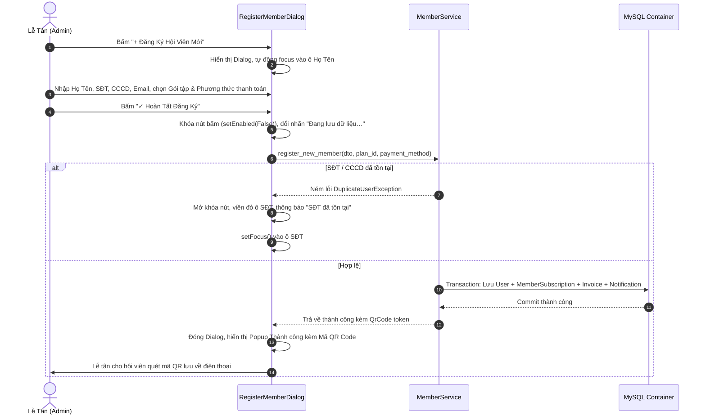
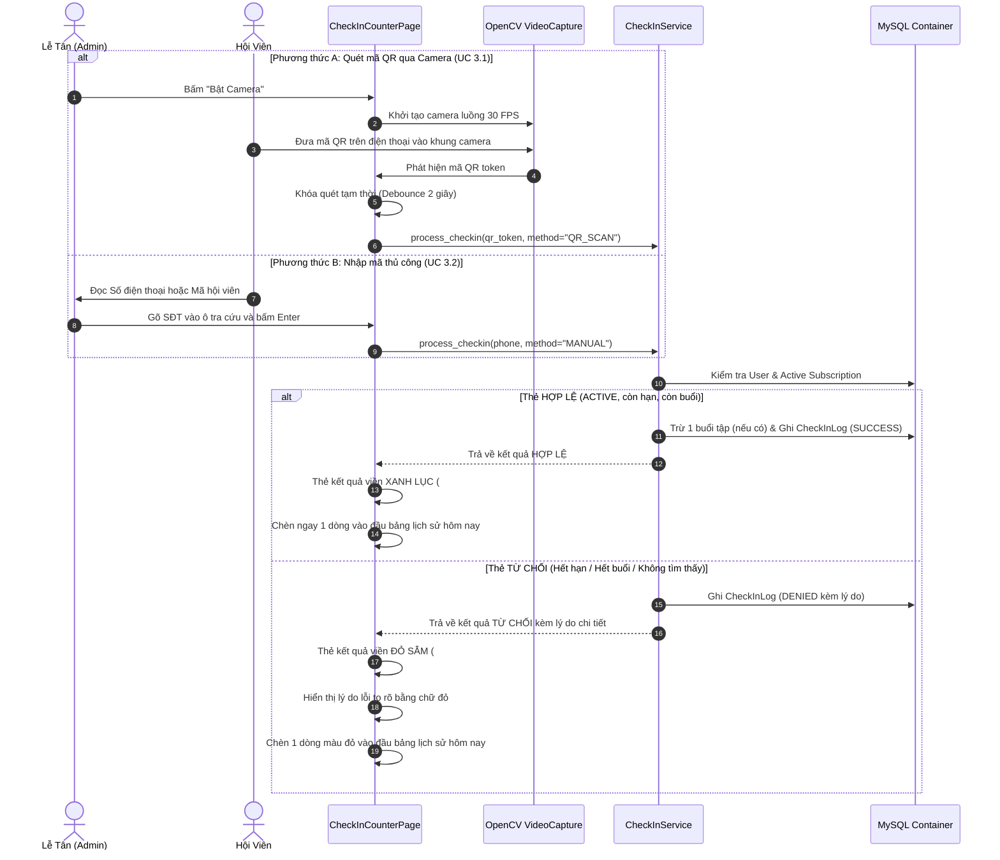

# QUY CHUẨN TRẢI NGHIỆM NGƯỜI DÙNG & LUỒNG TƯƠNG TÁC (PYTHON UX RULES)
## ÁP DỤNG CHO 2 TÍNH NĂNG: ĐĂNG KÝ HỘI VIÊN KÈM GÓI TẬP & ĐIỂM DANH HỘI VIÊN
**Tài liệu tham chiếu:** [`UI/task.md`](../UI/task.md) | [`doc/ref_ux_rules.md`](ref_ux_rules.md) | [`doc/python_ui_rules.md`](python_ui_rules.md)  
**Nền tảng:** Python 3.10.11 • PyQt6 Desktop • Tốc độ quầy $< 1\text{s}$ • Phòng vệ lỗi Idempotency • Zero-Friction

---

## MỤC TIÊU & TRIẾT LÝ UX CỐT LÕI

Tài liệu này quy định toàn bộ tiêu chuẩn **Trải nghiệm Người dùng & Luồng Tương tác Nghiệp vụ (UX - User Experience)** cho nhân viên Lễ tân và Thu ngân khi thao tác trên ứng dụng Desktop PyQt6, tập trung vào 2 tính năng trọng tâm:
1. **Đăng ký hội viên mới kèm gói tập (`UC02.1` + `UC05.1`)**
2. **Điểm danh hội viên vào phòng tập (`UC03.1` + `UC03.2`)**

> [!IMPORTANT]
> **Triết lý UX Cốt lõi Tại Quầy:**
> * **Tốc độ xử lý cực nhanh ($< 1\text{ giây}$):** Thao tác điểm danh hội viên phải trả kết quả tức thì. Lễ tân chỉ cần quét QR hoặc nhập SĐT rồi gõ `Enter` là hoàn tất, không bắt dùng chuột qua nhiều bước.
> * **Bảo vệ Giao dịch Tài chính (Idempotency):** Thanh toán hỗ trợ Tiền mặt và VietQR (không dùng máy quẹt thẻ POS). Triệt tiêu hoàn toàn lỗi double-click dẫn đến tạo trùng 2 hội viên, xuất 2 hóa đơn hoặc trừ 2 lượt tập.
> * **Không hiển thị mã kỹ thuật `(UC...)`:** Tuyệt đối không để lộ mã Use Case lên bất kỳ nhãn giao diện nào.
> * **Hoàn toàn KHÔNG dùng âm thanh phiền toái:** Không phát tiếng còi Beep/Buzz khi điểm danh. Kết quả truyền tải 100% bằng giao diện thị giác rõ ràng.

---

## 1. NGUYÊN TẮC TƯƠNG TÁC PHỔ QUÁT (UNIVERSAL UX PRINCIPLES)

### 1.1. Tự Do Nhập Liệu & Tuyệt Đối Không Chặn Dán (`Never Block Paste`)
* **Quy tắc Tự do Dán (Never Block Paste):**
  * Lễ tân có quyền dùng tổ hợp phím `Ctrl+V` để dán Số điện thoại, CCCD, Email từ Zalo, Facebook hoặc file Excel vào ô nhập liệu mà không bị chặn sự kiện hay xóa mất dữ liệu.
* **Tự động làm sạch dữ liệu đầu vào:**
  * Hệ thống tự động cắt bỏ khoảng trắng thừa đầu/cuối (`strip()`) khi người dùng dán hoặc nhập dữ liệu.

### 1.2. Phản Hồi Tức Thì & Khóa Nút Chống Gửi Trùng Lặp (Async Idempotency)
* Khi lễ tân nhấn nút thực hiện các hành động ghi dữ liệu nhạy cảm (`"✓ Hoàn Tất Đăng Ký"` hoặc `"Điểm Danh"`):
  1. Nút bấm **ngay lập tức chuyển sang trạng thái vô hiệu hóa (`setEnabled(False)`)** ngay tại khung hình đầu tiên.
  2. Đổi nhãn nút sang trạng thái đang xử lý kèm dấu ba chấm chuẩn: `"Đang lưu dữ liệu…"`.
  3. Sau khi Service trả về kết quả (thành công hoặc thất bại): Nút bấm mới được kích hoạt lại và khôi phục nhãn gốc.
  4. Triệt tiêu 100% nguy cơ người dùng click lặp lại làm phát sinh 2 hóa đơn hoặc trừ 2 lượt tập.

### 1.3. Báo Lỗi Nội Dòng & Tự Động Nhảy Tiêu Điểm (Focus Anchoring)
* **Hiển thị lỗi nội dòng:**
  * Khi kiểm tra form thất bại (ví dụ: Bỏ trống Họ tên, bỏ trống SĐT, hoặc SĐT đã tồn tại):
    * Ô nhập liệu vi phạm được đổi viền sang màu đỏ `#DC2626`.
    * Thông báo lỗi chi tiết xuất hiện ngay dưới ô nhập liệu bằng văn bản màu đỏ `#F87171`.
* **Tự động neo tiêu điểm bàn phím:**
  * Hệ thống tự động gọi hàm `setFocus()` đưa con trỏ chuột vào đúng ô bị lỗi đầu tiên để lễ tân chỉnh sửa ngay mà không cần dùng chuột click lại.

### 1.4. Phím Tắt & Điều Hướng Bàn Phím Tại Quầy (Keyboard Shortcuts)
* **Phím `Enter` thông minh:**
  * Tại ô tra cứu SĐT/Mã hội viên: Bấm `Enter` tự động kích hoạt hàm điểm danh.
  * Tại form đăng ký: Bấm `Enter` tại trường cuối cùng tự động gửi form đăng ký.
* **Phím `Escape`:**
  * Bấm `Escape` đóng hộp thoại `RegisterMemberDialog` an toàn mà không thực hiện hành động ghi dữ liệu.
* **Bẫy tiêu điểm hộp thoại (Modal Focus Trapping):**
  * Khi mở hộp thoại đăng ký, con trỏ phím tự động nằm tại ô nhập Họ tên (`txt_name`). Phím `Tab` chỉ luân chuyển giữa các trường bên trong hộp thoại, không nhảy ra ngoài màn hình chính phía sau.

### 1.5. Khả Năng Phục Hồi Khi Mất Kết Nối CSDL (Database Resiliency)
* Nếu MySQL Container tạm thời gặp sự cố mất kết nối hoặc quá tải:
  * Hiển thị thông báo dạng thanh cảnh báo hoặc hộp thoại rõ ràng: *"Không thể kết nối đến máy chủ CSDL. Vui lòng kiểm tra Docker Container!"*.
  * **TUYỆT ĐỐI KHÔNG XÓA DỮ LIỆU ĐANG NHẬP DỞ:** Giữ nguyên toàn bộ nội dung mà lễ tân vừa gõ trên form đăng ký để không bắt người dùng nhập lại từ đầu.

---

## 2. LUỒNG TƯƠNG TÁC CHI TIẾT TÍNH NĂNG 1: ĐĂNG KÝ HỘI VIÊN KÈM GÓI TẬP (`UC02.1` + `UC05.1`)

### Chi Tiết Từng Bước Thao Tác:
1. **Bước 1 (Mở form):** Lễ tân bấm nút `+ Đăng Ký Hội Viên Mới` trên trang Quản lý Hội viên. Con trỏ chuột tự động xuất hiện tại ô Họ tên.
2. **Bước 2 (Nhập liệu):** Lễ tân nhập thông tin khách hàng.
   * Danh mục gói tập hiển thị rõ ràng: `Tên gói — Đơn giá đ` (ví dụ: `Gym Standard 3 Tháng — 1.200.000 đ`).
   * Chọn phương thức thanh toán qua 2 RadioButton trực quan: `Tiền mặt` (`CASH`), `Quét mã VietQR` (`VIETQR`). Không sử dụng hình thức quẹt thẻ POS.
3. **Bước 3 (Xác nhận):** Bấm `"✓ Hoàn Tất Đăng Ký"`.
   * Hệ thống khóa nút, hiển thị trạng thái chờ.
   * Nếu thành công: Xuất hiện hộp thoại thành công hiển thị Mã hội viên mới (ví dụ: `HV-1002`) và mã QR định danh $200 \times 200\text{px}$ để khách chụp lại. Danh sách hội viên ở màn hình chính tự động làm mới.

---

## 3. LUỒNG TƯƠNG TÁC CHI TIẾT TÍNH NĂNG 2: ĐIỂM DANH HỘI VIÊN (`UC03.1` + `UC03.2`)

### Các Tình Huống Ngoại Lệ Nghiệp Vụ Xử Lý Tại Quầy:

1. **Khử Quét Trùng Lặp Camera (Debounce / Cooldown Guardrail):**
   * Khi hội viên đưa mã QR vào camera, webcam có thể đọc liên tục 30 lần trong 1 giây.
   * **Bắt buộc:** Áp dụng cơ chế Debounce 2 giây. Sau khi quét được 1 mã QR, hệ thống tạm dừng nhận diện tiếp mã đó trong 2 giây để tránh ghi nhận 2 lượt check-in liên tiếp cho 1 người.
2. **Hội viên quên mã QR:**
   * Lễ tân hỏi Số điện thoại khách hàng, gõ vào ô tìm kiếm và bấm `Enter`. Hệ thống tự động tra cứu thẻ đang `ACTIVE` của người đó và thực hiện điểm danh bình thường.
3. **Thẻ hết hạn hoặc hết số buổi:**
   * Không hiện popup modal làm gián đoạn dòng người đang xếp hàng.
   * Thẻ kết quả ở góc phải lập tức chuyển sang màu đỏ sẫm viền `#DC2626`, nhãn `TỪ CHỐI`, dòng thông báo lý do rõ ràng: *"Thẻ tập đã hết hạn từ ngày 15/10/2026"* hoặc *"Thẻ tập đã hết số lượt vào phòng"*. Lễ tân nhìn thấy ngay và thông báo cho khách hàng chuyển sang quầy gia hạn.
