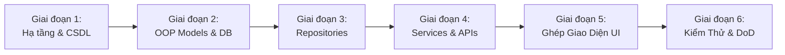

# KẾ HOẠCH TRIỂN KHAI CHI TIẾT (TASK.MD)
## Tính năng: Đăng ký Hội viên kèm Gói tập (UC02.1 + UC05.1) & Điểm danh Hội viên (UC03)
**Tài liệu lược đồ gốc:** [`doc/GymManagement_Physical_Model.sql`](GymManagement_Physical_Model.sql)  
**Bộ 3 Quy chuẩn kỹ thuật tham chiếu:** [`doc/python_dev_rules.md`](python_dev_rules.md) | [`doc/python_ui_rules.md`](python_ui_rules.md) | [`doc/python_ux_rules.md`](python_ux_rules.md)  
**Nền tảng:** Python 3.10.11 (PyQt6) • **Cơ sở dữ liệu:** MySQL 8.0 (Docker Container) • **Mô hình kiến trúc:** Layered OOP (Entity - Repository - Service - View)

---

## 1. MỤC TIÊU VÀ PHẠM VI TRIỂN KHAI

Áp dụng chính xác 100% lược đồ thực thể vật lý từ [`doc/GymManagement_Physical_Model.sql`](GymManagement_Physical_Model.sql) vào hệ thống Python Desktop hiện tại, triển khai trọn vẹn 2 luồng nghiệp vụ cốt lõi:

1. **Đăng ký hội viên mới cùng gói tập (UC02.1 + UC05.1):**
   * Tạo bản ghi `User` (Role = `MEMBER`, SĐT, Email, CCCD/UserName, Họ tên, Trạng thái `ACTIVE`).
   * Chọn `PackagePlan`, tính giá trị hóa đơn.
   * Tạo bản ghi `Invoice` (TransactionType = `NEW_REGISTRATION`, PaymentMethod = `CASH` hoặc `VIETQR`, Status = `PAID`). **Không sử dụng quẹt thẻ POS**.
   * Tạo bản ghi `MemberSubscription` (Status = `ACTIVE`, tính `StartDate`, `EndDate`, `RemainingCheckInSessions`, sinh mã token `QrCode`).
   * Tạo bản ghi `Notification` chào mừng hội viên mới.
2. **Điểm danh hội viên vào phòng tập (UC03.1 & UC03.2):**
   * Quét mã `QrCode` từ camera (UC 3.1) hoặc nhập thủ công `UserName` / `Phone` của hội viên (UC 3.2).
   * Tra cứu `MemberSubscription` đang có trạng thái `ACTIVE` của hội viên.
   * Kiểm tra điều kiện: `EndDate >= Ngày hiện tại`, `RemainingCheckInSessions > 0`.
   * Trừ 1 lượt `RemainingCheckInSessions` (nếu gói tính theo lượt).
   * Ghi bản ghi vào bảng `CheckInLog` (`Status` = `SUCCESS` hoặc `DENIED`, kèm `DenialReason`).

---

## 2. MA TRẬN ÁNH XẠ SCHEMA VẬT LÝ VÀO CÁC MODEL OOP (PHYSICAL SCHEMA TO OOP MODELS)

Toàn bộ các thực thể liên quan đến 2 tính năng được ánh xạ trực tiếp từ [`doc/GymManagement_Physical_Model.sql`](GymManagement_Physical_Model.sql):

| Bảng CSDL (Table Name) | Tệp Tin Model OOP (Python) | Thuộc Tính Chính (OOP Fields) | Vai Trò Nghiệp Vụ Trong 2 Feature |
| :--- | :--- | :--- | :--- |
| **`Role`** | `UI/models/role.py` | `role_id: str`, `role_name: str` | Định danh quyền `MEMBER`, `ADMIN`. |
| **`User`** | `UI/models/user.py` | `username: str`, `role_id: str`, `full_name: str`, `phone: str`, `email: str`, `password_hash: str`, `gender: int`, `status: str`, `created_at: date` | Lưu hồ sơ cá nhân hội viên và nhân viên lễ tân xác nhận. |
| **`PackagePlan`** | `UI/models/package_plan.py` | `plan_id: str`, `name: str`, `description: str`, `duration_days: int`, `price: float`, `max_check_in_sessions: int`, `is_pt_included: int`, `total_pt_sessions: int`, `is_active: int` | Danh mục gói dịch vụ gym niêm yết. |
| **`MemberSubscription`** | `UI/models/member_subscription.py` | `subscription_id: str`, `qr_code: str`, `start_date: date`, `end_date: date`, `remaining_check_in_sessions: int`, `remaining_pt_sessions: int`, `freeze_start_date: date`, `freeze_end_date: date`, `status: str`, `created_at: date`, `username: str`, `assigned_pt_id: str`, `plan_id: str`, `pt_session_id: str` | Quản lý vòng đời thẻ tập, thời hạn, lượt check-in còn lại và chuỗi mã QR. |
| **`Invoice`** | `UI/models/invoice.py` | `invoice_id: str`, `invoice_code: str`, `transaction_type: str`, `subtotal_amount: float`, `total_amount: int`, `payment_method: str`, `status: str`, `refund_amount: float`, `refund_reason: str`, `paid_at: date`, `username: str`, `subscription_id: str`, `created_by_admin_id: str`, `check_in_log_id: str` | Hóa đơn thu tiền khi đăng ký gói (Tiền mặt hoặc VietQR). |
| **`CheckInLog`** | `UI/models/check_in_log.py` | `check_in_id: str`, `check_in_at: datetime`, `status: str`, `denial_reason: str`, `subscription_id: str`, `verified_by_admin_id: str`, `username: str` | Nhật ký mỗi lượt vào phòng tập (hợp lệ hoặc từ chối). |
| **`Notification`** | `UI/models/notification.py` | `notification_id: str`, `title: str`, `message: str`, `is_read: bool`, `created_at: datetime`, `username: str` | Thông báo gửi tới hội viên khi kích hoạt gói thành công. |

---

## 3. CÂY THƯ MỤC CÁC TỆP TIN SỬ DỤNG (PROJECT DIRECTORY TREE)

```text
c:\Users\nguye\Desktop\Gym\
├── .github/
│   └── workflows/
│       └── ci.yml                                      # GitHub Actions CI Workflow (Lint, DB DDL, Pytest, UI Smoke)
├── docker-compose.yml                                  # Cấu hình Docker chạy MySQL 8.0
├── init_mysql.sql                                      # DDL MySQL chuyển đổi 1:1 từ GymManagement_Physical_Model.sql
├── .env.example                                        # Mẫu biến môi trường (Zero-Secrets)
├── requirements.txt                                    # Khai báo thư viện chuẩn Python 3.10.11
│
├── doc/
│   ├── task.md                                         # [TỆP NÀY] Kế hoạch chi tiết phân rã task
│   ├── python_dev_rules.md                             # Quy chuẩn phát triển (KISS, YAGNI, DRY, SOLID, Logging)
│   ├── python_ui_rules.md                              # Quy chuẩn giao diện thị giác (100% Dark Mode, Tokens)
│   └── python_ux_rules.md                              # Quy chuẩn trải nghiệm người dùng (< 1s, Idempotency)
│
└── UI/
    ├── config/
    │   ├── __init__.py
    │   └── settings.py                                 # Quản lý cấu hình & biến môi trường
    ├── constants.py                                    # Centralized Enums & Hằng số nghiệp vụ
    ├── exceptions.py                                   # Cây phân cấp ngoại lệ (Custom Exception Hierarchy)
    │
    ├── database/                                       # Quản lý kết nối MySQL
    │   ├── __init__.py
    │   └── db_connection.py                            # DatabaseConnection (Singleton Pool & Context Manager)
    │
    ├── models/                                         # Tầng Entity OOP tương ứng bảng SQL
    │   ├── __init__.py
    │   ├── base_model.py                               # Base Model hỗ trợ serialization/dict mapping
    │   ├── role.py                                     # Class Role (bảng Role)
    │   ├── user.py                                     # Class User (bảng User)
    │   ├── package_plan.py                             # Class PackagePlan (bảng PackagePlan)
    │   ├── member_subscription.py                      # Class MemberSubscription (bảng MemberSubscription)
    │   ├── invoice.py                                  # Class Invoice (bảng Invoice)
    │   ├── check_in_log.py                             # Class CheckInLog (bảng CheckInLog)
    │   └── notification.py                             # Class Notification (bảng Notification)
    │
    ├── repositories/                                   # Tầng Data Access Object (DAO Pattern)
    │   ├── __init__.py
    │   ├── base_repository.py                          # Generic BaseRepository[T]
    │   ├── user_repository.py                          # UserRepository (Tra cứu UserName, Phone, Email)
    │   ├── package_plan_repository.py                  # PackagePlanRepository (Lấy gói tập Active)
    │   ├── subscription_repository.py                  # SubscriptionRepository (Tìm gói Active, trừ CheckIn sessions)
    │   ├── invoice_repository.py                       # InvoiceRepository (Tạo hóa đơn, tìm theo mã)
    │   ├── check_in_repository.py                      # CheckInRepository (Lưu log, lấy danh sách hôm nay)
    │   └── notification_repository.py                  # NotificationRepository (Lưu thông báo)
    │
    ├── services/                                       # Tầng Nghiệp Vụ (Transaction & Rules)
    │   ├── __init__.py
    │   ├── vietqr_service.py                           # Tích hợp VietQR Sandbox API (requests & offline fallback)
    │   ├── member_service.py                           # MemberService: Đăng ký User + Subscription + Invoice + Notification
    │   └── checkin_service.py                          # CheckInService: Quét QR / SĐT -> Kiểm tra điều kiện -> Trừ lượt -> Ghi log
    │
    ├── utils/
    │   ├── __init__.py
    │   ├── profiler.py                                 # Decorator @measure_time kiểm soát độ trễ quầy
    │   └── validator.py                                # Tiện ích validate Số điện thoại, CCCD, Email
    │
    ├── tests/                                          # Tầng kiểm thử tự động (Pytest AAA Pattern)
    │   ├── __init__.py
    │   ├── test_member_service.py                      # Unit test luồng đăng ký hội viên
    │   ├── test_checkin_service.py                     # Unit test luồng điểm danh & trừ buổi
    │   └── test_integration_flow.py                    # Integration test end-to-end trên MySQL Docker
    │
    └── desktop_portal/                                 # Giao diện PyQt6
        ├── dialogs/
        │   ├── register_member_dialog.py               # Kết nối MemberService & VietQrService
        │   └── vietqr_dialog.py                        # Hộp thoại hiển thị VietQR động
        └── views/
            ├── checkin_counter_page.py                 # Kết nối CheckInService (Camera & Nhập tay)
            ├── members_page.py                         # Đọc danh sách hội viên thật từ CSDL
            └── pos_billing_page.py                     # Đọc danh mục gói tập thật từ CSDL
```

---

## 4. BẢNG PHÂN RÃ CHI TIẾT TỪNG TASK (PHASE-BY-PHASE DETAILED WORK BREAKDOWN)

Kế hoạch được chia thành **6 Giai đoạn (Phases)** với **22 Nhiệm vụ nguyên tử (Atomic Tasks)** được đặc tả chi tiết tiêu chí kỹ thuật:



---

### GIAI ĐOẠN 1: HẠ TẦNG DOCKER, CSDL MYSQL & MÔI TRƯỜNG PHÁT TRIỂN

#### ● Task 1.1: Thiết lập cấu hình Docker Container MySQL 8.0
* **Tệp tin:** `docker-compose.yml`
* **Mục tiêu:** Khởi chạy container MySQL 8.0 cô lập, phục vụ lưu trữ dữ liệu bền vững qua volume.
* **Quy chuẩn kỹ thuật:**
  * Image: `mysql:8.0`
  * Cổng ánh xạ: `3306:3306`
  * Môi trường: `MYSQL_ROOT_PASSWORD`, `MYSQL_DATABASE=gym_management_db`, `MYSQL_USER=gym_user`, `MYSQL_PASSWORD=gym_password@2026`
  * Encoding: `--character-set-server=utf8mb4 --collation-server=utf8mb4_unicode_ci`
  * Gắn volume bền vững: `gym_mysql_data:/var/lib/mysql`
  * Tự động chạy script khởi tạo: `./init_mysql.sql:/docker-entrypoint-initdb.d/init_mysql.sql`
* **Tiêu chí nghiệm thu (DoD):**
  * Lệnh `docker-compose up -d` khởi chạy container ở trạng thái `healthy` hoặc `running`.
  * Có thể kết nối qua cổng 3306 bằng tài khoản `gym_user`.

#### ● Task 1.2: Xây dựng kịch bản DDL MySQL từ `GymManagement_Physical_Model.sql`
* **Tệp tin:** `init_mysql.sql`
* **Mục tiêu:** Tạo 7 bảng quan hệ khớp 100% tên bảng và tên cột với tài liệu vật lý, nạp dữ liệu mẫu ban đầu.
* **Chi tiết thực thi:**
  1. Bảng `Role`: Khóa chính `RoleID VARCHAR(10)`. Seed data: `ADMIN`, `MEMBER`, `PT`.
  2. Bảng `User`: Khóa chính `UserName VARCHAR(10)`, Khóa ngoại `RoleID`, Unique index trên `Phone`.
  3. Bảng `PackagePlan`: Khóa chính `PlanId VARCHAR(10)`, giá tiền `DECIMAL(19, 0)`, thời hạn `DurationDays INT`, `MaxCheckInSessions INT`. Seed data: 5 gói tập niêm yết từ `mock_data.py`.
  4. Bảng `MemberSubscription`: Khóa chính `SubscriptionId VARCHAR(10)`, Unique index `QrCode`, Khóa ngoại `UserName` và `PlanId`.
  5. Bảng `Invoice`: Khóa chính `InvoiceId VARCHAR(10)`, Unique `InvoiceCode`, Khóa ngoại `UserName` và `SubscriptionId`.
  6. Bảng `CheckInLog`: Khóa chính `CheckInId VARCHAR(10)`, Khóa ngoại `SubscriptionId` và `UserName`.
  7. Bảng `Notification`: Khóa chính `NotificationId VARCHAR(10)`, Khóa ngoại `UserName`.
* **Tiêu chí nghiệm thu (DoD):**
  * Script thực thi thành công không lỗi cú pháp trên MySQL 8.0.
  * Các ràng buộc khóa ngoại (Foreign Key) và Index được thiết lập đầy đủ.

#### ● Task 1.3: Cấu hình biến môi trường & Quản trị bí mật (Zero-Secrets Rule)
* **Tệp tin:** `.env.example`, `.env`, `UI/config/settings.py`
* **Mục tiêu:** Tuân thủ nguyên tắc Zero-Secrets trong [python_dev_rules.md](python_dev_rules.md), tuyệt đối không hardcode mật khẩu hay API key trong mã nguồn.
* **Chi tiết thực thi:**
  * Tạo `.env.example` chứa các biến mẫu:
    ```ini
    DB_HOST=127.0.0.1
    DB_PORT=3306
    DB_NAME=gym_management_db
    DB_USER=gym_user
    DB_PASSWORD=gym_password@2026
    VIETQR_CLIENT_ID=
    VIETQR_API_KEY=
    VIETQR_ACCOUNT_NO=0987654321
    VIETQR_ACCOUNT_NAME=HE THONG PHONG TAP GYM
    VIETQR_BANK_BIN=970422
    ```
  * Tạo class `Settings` tại `UI/config/settings.py` sử dụng `python-dotenv` để load và cung cấp cấu hình tập trung.
* **Tiêu chí nghiệm thu (DoD):**
  * File `.env` được liệt kê trong `.gitignore`.
  * `settings.py` đọc đúng các giá trị mặc định nếu `.env` chưa có giá trị.

---

### GIAI ĐOẠN 2: KẾT NỐI CSDL & TẦNG THỰC THỂ OOP (MODELS & CONNECTION)

#### ● Task 2.1: Triển khai lớp quản lý kết nối CSDL Singleton Connection Pool
* **Tệp tin:** `UI/database/db_connection.py`
* **Mục tiêu:** Cung cấp kết nối MySQL an toàn luồng (Thread-safe) sử dụng connection pooling và Context Manager.
* **Quy chuẩn kỹ thuật:**
  * Áp dụng Design Pattern: **Singleton Connection Pool** (`mysql.connector.pooling.MySQLConnectionPool`).
  * Phương thức `get_connection()`: Cấp phát kết nối từ pool.
  * Context Manager `@contextmanager def transaction()`: Tự động `commit()` khi hoàn thành, tự động `rollback()` khi gặp lỗi ngoại lệ, luôn `close()` cursor/connection trong khối `finally`.
  * Bọc lỗi kết nối cấp thấp thành `DatabaseTransactionException` kèm `raise ... from err`.
* **Tiêu chí nghiệm thu (DoD):**
  * Gọi được `with db.transaction() as cursor:` thực thi lệnh thử nghiệm thành công.
  * Mô phỏng lệnh SQL lỗi -> Hệ thống tự rollback an toàn, không rò rỉ kết nối.

#### ● Task 2.2: Xây dựng hằng số tập trung & Cây phân cấp ngoại lệ
* **Tệp tin:** `UI/constants.py`, `UI/exceptions.py`
* **Mục tiêu:** Triệt tiêu số/chuỗi ma thuật (No Magic Numbers/Strings) và xây dựng hệ thống báo lỗi ngữ nghĩa cao.
* **Chi tiết thực thi:**
  * `UI/constants.py`:
    * `RoleID`: `MEMBER = "MEMBER"`, `ADMIN = "ADMIN"`.
    * `SubscriptionStatus`: `ACTIVE`, `EXPIRED`, `FROZEN`, `CANCELLED`.
    * `PaymentMethod`: `CASH = "CASH"`, `VIETQR = "VIETQR"`.
    * `CheckInStatus`: `SUCCESS = "SUCCESS"`, `DENIED = "DENIED"`.
    * `CheckInMethod`: `QR_SCAN = "QR_SCAN"`, `MANUAL = "MANUAL"`.
  * `UI/exceptions.py`:
    * `GymBaseException(message, error_code)`
    * `DuplicateUserException(field_name, value)`
    * `PackageNotFoundException(plan_id)`
    * `SubscriptionExpiredException(message, end_date)`
    * `CheckInDeniedException(reason, username)`
    * `DatabaseTransactionException(original_error)`
* **Tiêu chí nghiệm thu (DoD):**
  * Toàn bộ ngoại lệ kế thừa từ `GymBaseException`.
  * Có thuộc tính `error_code` hỗ trợ truy vết lỗi nhanh.

#### ● Task 2.3: Xây dựng BaseModel và 7 Thực thể OOP (Domain Entities)
* **Tệp tin:** `UI/models/base_model.py`, `role.py`, `user.py`, `package_plan.py`, `member_subscription.py`, `invoice.py`, `check_in_log.py`, `notification.py`
* **Mục tiêu:** Định nghĩa các lớp thực thể OOP thuần túy (POPO - Plain Old Python Objects) đại diện cho dữ liệu nghiệp vụ.
* **Quy chuẩn kỹ thuật (Tuân thủ KISS, SRP, Type Hints 100%):**
  * `BaseModel`: Cung cấp phương thức `to_dict()`, `from_row(row_dict)`.
  * `User`: Chứa các thuộc tính khớp bảng `User` (`username`, `role_id`, `full_name`, `phone`, `email`, `password_hash`, `gender`, `status`, `created_at`). Bổ sung phương thức `is_active() -> bool`.
  * `PackagePlan`: Chứa các thuộc tính khớp bảng `PackagePlan` (`plan_id`, `name`, `duration_days`, `price`, `max_check_in_sessions`...).
  * `MemberSubscription`: Bổ sung phương thức nghiệp vụ cốt lõi:
    ```python
    def is_eligible_for_checkin(self, target_date: date = None) -> Tuple[bool, str]:
        # Guard clause: Kiểm tra ACTIVE, EndDate, RemainingSessions
    ```
  * `Invoice`: Thuộc tính khớp bảng `Invoice`. Chỉ chấp nhận `payment_method` là `CASH` hoặc `VIETQR`.
  * `CheckInLog`: Thuộc tính khớp bảng `CheckInLog`.
  * `Notification`: Thuộc tính khớp bảng `Notification`.
* **Tiêu chí nghiệm thu (DoD):**
  * 100% các class có Type Hints đầy đủ và Docstring Google-style.
  * Tên thuộc tính ánh xạ chuẩn xác với các cột CSDL.

---

### GIAI ĐOẠN 3: TẦNG DATA ACCESS LAYER (REPOSITORY PATTERN)

#### ● Task 3.1: Xây dựng Abstract Base Repository
* **Tệp tin:** `UI/repositories/base_repository.py`
* **Mục tiêu:** Cung cấp khung thao tác CSDL chuẩn hóa (Generic Pattern), cách ly hoàn toàn câu lệnh SQL.
* **Chi tiết thực thi:**
  * Lớp trừu tượng `BaseRepository[T]` định nghĩa: `get_by_id(id)`, `get_all()`.
  * Hỗ trợ hàm trợ giúp thực thi SQL an toàn có tham số hóa `%s` (`execute_query`, `execute_scalar`).
  * Tự động wrap lỗi `mysql.connector.Error` thành `DatabaseTransactionException`.

#### ● Task 3.2: Triển khai UserRepository
* **Tệp tin:** `UI/repositories/user_repository.py`
* **Mục tiêu:** Xử lý toàn bộ truy vấn liên quan đến tài khoản người dùng và hồ sơ hội viên.
* **Phương thức cần có:**
  * `create_with_cursor(cursor, user: User) -> None`: Thực thi INSERT trong transaction hiện hành.
  * `find_by_username(username: str) -> Optional[User]`: Tra cứu theo mã hội viên / tên đăng nhập.
  * `find_by_phone(phone: str) -> Optional[User]`: Kiểm tra trùng số điện thoại.
  * `find_by_phone_or_username(search_key: str) -> Optional[User]`: Phục vụ tra cứu thủ công tại quầy điểm danh.
  * `get_all_members(limit: int = 100) -> List[User]`: Lấy danh sách hội viên cho trang quản lý.

#### ● Task 3.3: Triển khai PackagePlanRepository
* **Tệp tin:** `UI/repositories/package_plan_repository.py`
* **Mục tiêu:** Truy xuất danh mục gói dịch vụ niêm yết.
* **Phương thức cần có:**
  * `get_active_plans() -> List[PackagePlan]`: Lấy danh sách gói đang kinh doanh (`is_Active = 1`).
  * `get_by_id(plan_id: str) -> Optional[PackagePlan]`: Lấy thông tin chi tiết gói tập theo mã.

#### ● Task 3.4: Triển khai SubscriptionRepository
* **Tệp tin:** `UI/repositories/subscription_repository.py`
* **Mục tiêu:** Quản trị vòng đời thẻ tập, thời hạn và số buổi check-in.
* **Phương thức cần có:**
  * `create_with_cursor(cursor, sub: MemberSubscription) -> None`: Kích hoạt thẻ mới trong transaction.
  * `find_by_qrcode(qr_token: str) -> Optional[MemberSubscription]`: Tra cứu thẻ bằng mã QR từ camera.
  * `find_active_by_username(username: str) -> Optional[MemberSubscription]`: Lấy thẻ đang `ACTIVE` mới nhất của hội viên.
  * `decrement_sessions(subscription_id: str) -> bool`: Giảm 1 lượt `RemainingCheckInSessions` khi điểm danh thành công.

#### ● Task 3.5: Triển khai InvoiceRepository & NotificationRepository
* **Tệp tin:** `UI/repositories/invoice_repository.py`, `UI/repositories/notification_repository.py`
* **Mục tiêu:** Lưu trữ hóa đơn thu tiền và thông báo hệ thống.
* **Phương thức cần có:**
  * `InvoiceRepository.create_with_cursor(cursor, invoice: Invoice) -> None`
  * `InvoiceRepository.get_recent_invoices(limit: int = 50) -> List[Invoice]`
  * `NotificationRepository.create_with_cursor(cursor, noti: Notification) -> None`

#### ● Task 3.6: Triển khai CheckInRepository
* **Tệp tin:** `UI/repositories/check_in_repository.py`
* **Mục tiêu:** Lưu vết lượt ra/vào và truy vấn lịch sử điểm danh hôm nay.
* **Phương thức cần có:**
  * `create(log: CheckInLog) -> None`: Ghi nhận 1 lượt điểm danh (thành công hoặc bị từ chối).
  * `get_today_logs(limit: int = 50) -> List[dict]`: Lấy danh sách điểm danh trong ngày (kèm Họ tên hội viên qua JOIN bảng `User`) để nạp vào bảng quầy lễ tân.

---

### GIAI ĐOẠN 4: TẦNG NGHIỆP VỤ (SERVICE LAYER & EXTERNAL APIS)

#### ● Task 4.1: Tích hợp Dịch vụ VietQR Sandbox API
* **Tệp tin:** `UI/services/vietqr_service.py`
* **Mục tiêu:** Gọi API Sandbox của VietQR (`https://api.vietqr.io/v2/generate`) bằng thư viện `requests` để sinh mã QR động chứa số tiền và nội dung chuyển khoản, kèm cơ chế fallback tạo mã offline bằng `qrcode`.
* **Chi tiết thực thi:**
  * Đọc `VIETQR_CLIENT_ID`, `VIETQR_API_KEY`, `VIETQR_ACCOUNT_NO`, `VIETQR_BANK_BIN` từ `settings.py`.
  * Hàm `generate_qr_payment(amount: int, order_code: str) -> Tuple[bool, str]`:
    * Gửi HTTP POST tới VietQR API kèm timeout 5 giây.
    * Nếu API trả về `code == "00"`: Lấy chuỗi Base64 DataURL trả về.
    * Nếu mất mạng hoặc API lỗi: Tự động fallback dùng thuật toán sinh chuỗi chuẩn EMVCo cục bộ và render mã QR bằng thư viện `qrcode`. Không để quầy lễ tân bị treo.
* **Tiêu chí nghiệm thu (DoD):**
  * Trả về ảnh mã QR hợp lệ cả khi có mạng lẫn khi ngắt kết nối mạng.

#### ● Task 4.2: Xây dựng MemberService (Nghiệp vụ UC02.1 & UC05.1)
* **Tệp tin:** `UI/services/member_service.py`
* **Mục tiêu:** Thực thi nghiệp vụ Đăng ký hội viên mới, kích hoạt gói tập và lập hóa đơn thu tiền trong một Transaction an toàn (All-or-Nothing).
* **Quy trình chi tiết:**
  1. **Fail-Fast Validation:** Kiểm tra rỗng Họ tên, Số điện thoại. Kiểm tra định dạng SĐT (10 số) và Email.
  2. **Kiểm tra trùng lặp:** Gọi `user_repo.find_by_phone(phone)` và `find_by_username(username)`. Nếu trùng -> Ném `DuplicateUserException`.
  3. **Tra cứu gói tập:** Lấy `PackagePlan` từ `plan_id`. Nếu không thấy -> Ném `PackageNotFoundException`.
  4. **Tính toán thời hạn:** `start_date = date.today()`, `end_date = start_date + timedelta(days=plan.duration_days)`.
  5. **Sinh mã định danh:**
     * `username = f"HV-{uuid4().hex[:6].upper()}"`
     * `qr_code_token = f"GYM-QR-{username}-{uuid4().hex[:8]}"`
     * `invoice_code = f"HD-{datetime.now().strftime('%Y%m%d%H%M%S')}"`
  6. **Mở Transaction:**
     ```python
     with self.db.transaction() as cursor:
         user_repo.create_with_cursor(cursor, new_user)
         sub_repo.create_with_cursor(cursor, new_sub)
         invoice_repo.create_with_cursor(cursor, new_invoice)
         noti_repo.create_with_cursor(cursor, new_noti)
     ```
  7. **Ghi log & Trả về kết quả:** Ghi log `INFO` và trả về kết quả kèm chuỗi mã QR.
* **Tiêu chí nghiệm thu (DoD):**
  * Dữ liệu được ghi đồng thời vào 4 bảng. Nếu 1 bảng lỗi, toàn bộ dữ liệu bị rollback sạch sẽ.

#### ● Task 4.3: Xây dựng CheckInService (Nghiệp vụ UC03.1 & UC03.2)
* **Tệp tin:** `UI/services/checkin_service.py`
* **Mục tiêu:** Thực thi nghiệp vụ Điểm danh kiểm soát vào phòng tập, kiểm tra điều kiện thẻ và tự động trừ buổi.
* **Quy trình chi tiết:**
  1. **Nhận diện phương thức:**
     * Nếu `method == "QR_SCAN"`: Tìm thẻ qua `sub_repo.find_by_qrcode(key)`.
     * Nếu `method == "MANUAL"`: Tìm `User` qua `user_repo.find_by_phone_or_username(key)`, sau đó tìm thẻ `ACTIVE` qua `sub_repo.find_active_by_username(user.username)`.
  2. **Trường hợp không tìm thấy hội viên/thẻ:**
     * Ghi nhận `CheckInLog` thất bại (`Status = "DENIED"`, `DenialReason = "Không tìm thấy thẻ tập hoặc hội viên"`).
     * Ném `CheckInDeniedException`.
  3. **Trường hợp tìm thấy thẻ:**
     * Gọi `sub.is_eligible_for_checkin()`.
     * Nếu **Không đủ điều kiện** (Hết hạn, hết lượt, bị khóa):
       * Ghi `CheckInLog` thất bại (`Status = "DENIED"`, `DenialReason = lý_do`).
       * Ném `CheckInDeniedException`.
     * Nếu **Hợp lệ**:
       * Nếu gói có giới hạn lượt (`remaining_check_in_sessions > 0`): Gọi `sub_repo.decrement_sessions(sub.subscription_id)`.
       * Ghi `CheckInLog` thành công (`Status = "SUCCESS"`).
  4. **Ghi log & Trả về dữ liệu quầy:** Trả về Họ tên, Mã HV, Tên gói tập, Hạn dùng, Số buổi còn lại để UI hiển thị thẻ xanh.
* **Tiêu chí nghiệm thu (DoD):**
  * Thời gian thực thi toàn bộ hàm $< 200\text{ms}$.
  * Trừ đúng 1 buổi tập trong CSDL khi điểm danh thành công.

---

### GIAI ĐOẠN 5: TÍCH HỢP GIAO DIỆN PYQT6 (PRESENTATION INTEGRATION)

#### ● Task 5.1: Cải tạo Hộp thoại Đăng Ký Hội Viên Mới
* **Tệp tin:** `UI/desktop_portal/dialogs/register_member_dialog.py`
* **Mục tiêu:** Kết nối giao diện đăng ký với `MemberService` thật, loại bỏ hoàn toàn `mock_data.py`.
* **Quy chuẩn UI/UX bắt buộc (Tuân thủ `python_ui_rules.md` & `python_ux_rules.md`):**
  * **100% Dark Mode:** Nền `#162032`, viền `#334155`, chữ `#F8FAFC`.
  * **Phương thức thanh toán:** Chỉ gồm 2 RadioButton: `Tiền mặt` và `Chuyển khoản VietQR`. **Tuyệt đối không có lựa chọn quẹt thẻ POS**.
  * **Nếu chọn VietQR:** Mở hộp thoại `VietQrPaymentDialog` hiển thị mã QR động lấy từ `VietQrService`.
  * **Idempotency Guardrail:** Khi nhấn `"✓ Hoàn Tất Đăng Ký"`, nút lập tức chuyển sang `setEnabled(False)` và đổi nhãn `"Đang lưu dữ liệu…"`.
  * **Never Block Paste:** Cho phép dán (Ctrl+V) vào ô SĐT, CCCD, Email.
  * **Inline Error & Focus Anchoring:** Nếu vi phạm (ví dụ trùng SĐT), viền ô đỏ lên, hiển thị lỗi màu đỏ phía dưới và gọi `setFocus()` tới ô lỗi đầu tiên.
  * **Mã QR thành công:** Sau khi lưu thành công, hiển thị modal thông báo kèm widget mã QR của hội viên vừa tạo.
* **Tiêu chí nghiệm thu (DoD):**
  * Đăng ký hội viên mới thành công và xuất hiện trong MySQL.
  * Không thể click đúp nút submit.

#### ● Task 5.2: Cải tạo Màn hình Quầy Điểm Danh Check-in
* **Tệp tin:** `UI/desktop_portal/views/checkin_counter_page.py`
* **Mục tiêu:** Kết nối quầy điểm danh với `CheckInService` thật, hỗ trợ camera quét QR và nhập tay SĐT.
* **Quy chuẩn UI/UX bắt buộc:**
  * **Tốc độ phản hồi $< 1\text{ giây}$.**
  * **OpenCV QR Detection:** Sử dụng `cv2.QRCodeDetector()` quét mã QR từ luồng webcam. Áp dụng cơ chế **Debounce 2 giây** để chống quét trùng liên tiếp cùng một mã.
  * **Tra cứu thủ công:** Ô tìm kiếm hỗ trợ nhập SĐT hoặc Mã HV, bắt sự kiện phím `Enter`.
  * **Visual Feedback Card:**
    * Nếu HỢP LỆ: Khung thẻ sáng viền xanh lá `#059669`, chip `HỢP LỆ` (`#4ADE80` trên nền `#064E3B`), hiển thị Họ tên to rõ, số buổi còn lại.
    * Nếu TỪ CHỐI: Khung thẻ viền đỏ `#DC2626`, chip `TỪ CHỐI` (`#F87171` trên nền `#7F1D1D`), hiển thị dòng lý do từ chối to rõ bằng chữ đỏ.
  * **Zero Sound Rule:** Tuyệt đối không phát tiếng bíp còi gây ồn ào.
  * **Real-time Log Prepend:** Chèn ngay kết quả vừa điểm danh vào dòng đầu tiên (dòng 0) của bảng nhật ký hôm nay mà không bắt tải lại trang.
* **Tiêu chí nghiệm thu (DoD):**
  * Quét QR hoặc nhập SĐT điểm danh thành công trong $< 1$ giây.
  * Số buổi còn lại trên CSDL giảm đi 1 ngay lập tức.

#### ● Task 5.3: Đồng bộ dữ liệu thật trên MembersPage và PosBillingPage
* **Tệp tin:** `UI/desktop_portal/views/members_page.py`, `UI/desktop_portal/views/pos_billing_page.py`
* **Mục tiêu:** Thay thế dữ liệu giả lập `mock_data.py` bằng dữ liệu sống từ `UserRepository` và `PackagePlanRepository`.
* **Tiêu chí nghiệm thu (DoD):**
  * `MembersPage` tải danh sách hội viên thật từ bảng `User` và `MemberSubscription`.
  * `PosBillingPage` nạp danh mục gói tập thật từ bảng `PackagePlan`.

---

### GIAI ĐOẠN 6: KIỂM THỬ TỰ ĐỘNG & NGHIỆM THU HỆ THỐNG

#### ● Task 6.1: Viết Unit Tests cho MemberService và CheckInService
* **Tệp tin:** `UI/tests/test_member_service.py`, `UI/tests/test_checkin_service.py`
* **Mục tiêu:** Kiểm thử toàn bộ các nhánh rẽ nghiệp vụ độc lập không phụ thuộc CSDL bằng Mock Repository.
* **Các ca kiểm thử bắt buộc (AAA Pattern):**
  * `test_register_member_success`: Đăng ký thành công trả về đúng mã QR và invoice code.
  * `test_register_member_duplicate_phone_fails`: Trùng SĐT phải ném `DuplicateUserException`.
  * `test_checkin_success_and_decrement_session`: Điểm danh hợp lệ trừ 1 buổi tập.
  * `test_checkin_denied_when_expired`: Gói hết hạn phải trả về `DENIED` và ghi log từ chối.
  * `test_checkin_denied_when_sessions_exhausted`: Gói hết lượt phải từ chối.

#### ● Task 6.2: Viết Integration Test kiểm thử luồng thực tế trên MySQL Docker
* **Tệp tin:** `UI/tests/test_integration_flow.py`
* **Mục tiêu:** Kiểm thử chu trình liên hoàn (End-to-End) trên container MySQL thật:
  * Bước 1: Khởi tạo kết nối tới MySQL container.
  * Bước 2: Gọi `MemberService` đăng ký hội viên mới với gói 10 buổi.
  * Bước 3: Kiểm tra trong CSDL: Bảng `User`, `MemberSubscription`, `Invoice` đều có bản ghi.
  * Bước 4: Lấy mã QR vừa tạo truyền vào `CheckInService.process_checkin()`.
  * Bước 5: Kiểm tra số buổi còn lại trong CSDL giảm còn 9 buổi.
  * Bước 6: Dọn dẹp dữ liệu test.

#### ● Task 6.3: Thẩm định Tiêu chuẩn Nghiệm thu Hoàn thành (Definition of Done Audit)
* **Mục tiêu:** Rà soát toàn bộ dự án theo bảng kiểm định chất lượng:
  * [ ] Docker MySQL container chạy ổn định trên cổng 3306.
  * [ ] 100% tên bảng và cột khớp với `GymManagement_Physical_Model.sql`.
  * [ ] Không có mã SQL trong UI, không có mã PyQt6 trong Repository/Service.
  * [ ] Không có hình thức thanh toán POS (chỉ có Tiền mặt và VietQR).
  * [ ] Không hiển thị mã `UC...` lên giao diện người dùng.
  * [ ] Đạt chuẩn 100% Dark Mode theo bảng Design Tokens.
  * [ ] Khóa nút chống double-click hoạt động hoàn hảo.
  * [ ] 100% bài test trong `UI/tests/` chạy Passed (`pytest UI/tests`).

#### ● Task 6.4: Thiết lập & Kiểm chứng GitHub Actions CI Pipeline
* **Tệp tin:** `.github/workflows/ci.yml`
* **Mục tiêu:** Tự động hóa 4 Quality Gates trước khi cho phép merge code vào nhánh `main`:
  * Gate 1: Kiểm tra lỗi cú pháp và linting flake8.
  * Gate 2: Khởi chạy MySQL 8.0 container và thực thi nạp DDL `init_mysql.sql`.
  * Gate 3: Thực thi toàn bộ Pytest unit & integration tests.
  * Gate 4: Chạy PyQt6 Headless Smoke Test (Offscreen) đảm bảo giao diện không bị crash khi import.

---

## 5. BẢNG TỔNG HỢP MA TRẬN 23 TASK NGUYÊN TỬ

| Mã Task | Tên Nhiệm Vụ Chi Tiết | Tầng Kiến Trúc | Tệp Tin Tác Động Chính | Độ Ưu Tiên |
| :--- | :--- | :--- | :--- | :--- |
| **TSK-01** | Cấu hình Docker Container MySQL 8.0 | Infrastructure | `docker-compose.yml` | `P0 (Chặn)` |
| **TSK-02** | Xây dựng kịch bản DDL MySQL 7 bảng & Seed data | Database DDL | `init_mysql.sql` | `P0 (Chặn)` |
| **TSK-03** | Cấu hình biến môi trường & Zero-Secrets | Configuration | `.env.example`, `UI/config/settings.py` | `P1` |
| **TSK-04** | Cài đặt Singleton Connection Pool & Transaction Manager | Database Access | `UI/database/db_connection.py` | `P0 (Chặn)` |
| **TSK-05** | Xây dựng Hằng số nghiệp vụ & Cây phân cấp ngoại lệ | Core / Utils | `UI/constants.py`, `UI/exceptions.py` | `P1` |
| **TSK-06** | Xây dựng BaseModel và Entity Role & User | OOP Models | `UI/models/base_model.py`, `role.py`, `user.py` | `P1` |
| **TSK-07** | Xây dựng Entity PackagePlan & MemberSubscription | OOP Models | `UI/models/package_plan.py`, `member_subscription.py`| `P1` |
| **TSK-08** | Xây dựng Entity Invoice, CheckInLog, Notification | OOP Models | `UI/models/invoice.py`, `check_in_log.py`, `notification.py`| `P1` |
| **TSK-09** | Xây dựng Abstract BaseRepository Generic | Data Access | `UI/repositories/base_repository.py` | `P1` |
| **TSK-10** | Xây dựng UserRepository (Tìm SĐT/UserName) | Data Access | `UI/repositories/user_repository.py` | `P1` |
| **TSK-11** | Xây dựng PackagePlanRepository (Lấy gói Active) | Data Access | `UI/repositories/package_plan_repository.py` | `P1` |
| **TSK-12** | Xây dựng SubscriptionRepository (Tìm QR, trừ buổi) | Data Access | `UI/repositories/subscription_repository.py` | `P1` |
| **TSK-13** | Xây dựng InvoiceRepository & NotificationRepository | Data Access | `UI/repositories/invoice_repository.py`, `notification_repo.py` | `P1` |
| **TSK-14** | Xây dựng CheckInRepository (Ghi log, lấy log hôm nay)| Data Access | `UI/repositories/check_in_repository.py` | `P1` |
| **TSK-15** | Tích hợp Dịch vụ VietQR Sandbox API bằng requests | Service / API | `UI/services/vietqr_service.py` | `P1` |
| **TSK-16** | Xây dựng MemberService (Giao dịch tạo hội viên mới) | Service / Domain | `UI/services/member_service.py` | `P0` |
| **TSK-17** | Xây dựng CheckInService (Kiểm tra thẻ & trừ lượt) | Service / Domain | `UI/services/checkin_service.py` | `P0` |
| **TSK-18** | Tích hợp RegisterMemberDialog (Form đăng ký & VietQR)| Presentation | `UI/desktop_portal/dialogs/register_member_dialog.py` | `P0` |
| **TSK-19** | Tích hợp CheckInCounterPage (Camera QR & Nhập tay) | Presentation | `UI/desktop_portal/views/checkin_counter_page.py` | `P0` |
| **TSK-20** | Đồng bộ dữ liệu thật trên MembersPage & PosBillingPage| Presentation | `UI/desktop_portal/views/members_page.py`, `pos_billing_page.py`| `P2` |
| **TSK-21** | Viết Unit Test Suite cho Services (Pytest AAA) | Testing | `UI/tests/test_member_service.py`, `test_checkin_service.py` | `P1` |
| **TSK-22** | Viết Integration Test end-to-end trên MySQL Docker | Testing | `UI/tests/test_integration_flow.py` | `P1` |
| **TSK-23** | Thiết lập & Kiểm chứng GitHub Actions CI Pipeline | CI / DevOps | `.github/workflows/ci.yml` | `P1` |
